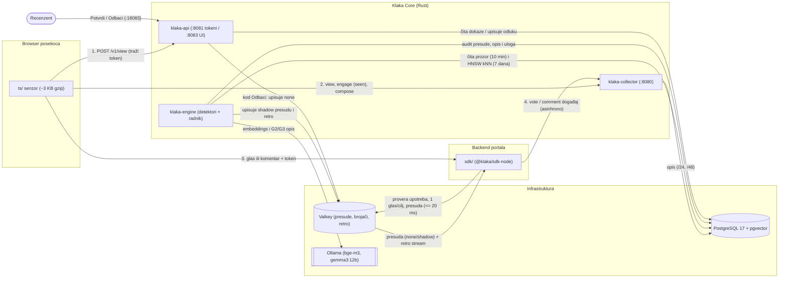
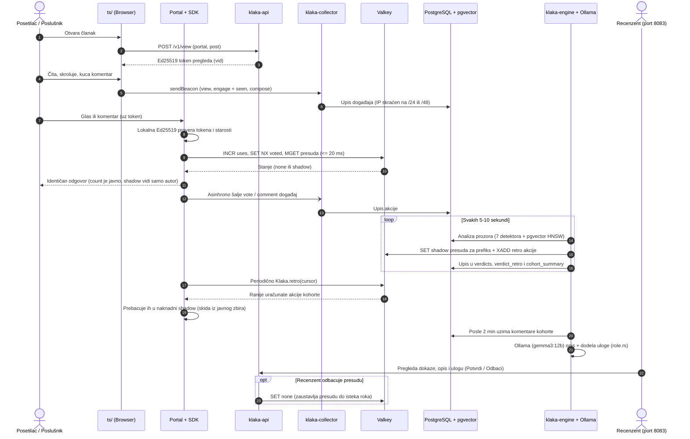
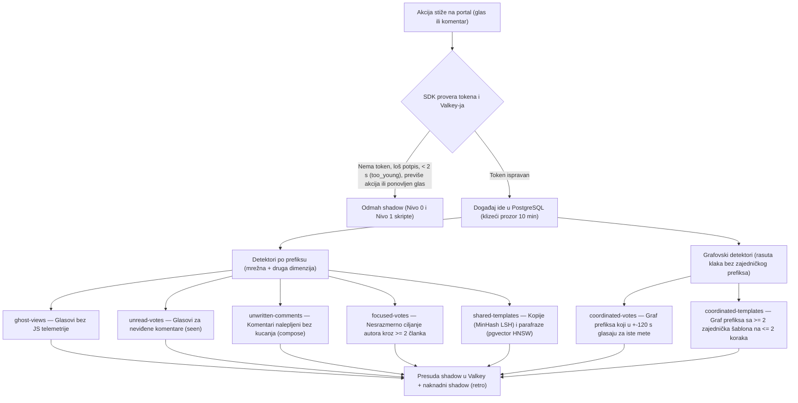

# Klaka

Detekcija koordinisanih manipulacija (glasovi i komentari) na informativnim portalima —
**isključivo iz podataka koje portal sam može da prikupi**, bez uvida u druge sajtove, bez
praćenja korisnika kroz mrežu i bez čuvanja punih IP adresa.

Polazna tačka za dublje čitanje: [`docs/koncept_detekcija_sa_portala.md`](docs/koncept_detekcija_sa_portala.md) ·
Pojmovi: [`docs/recnik.md`](docs/recnik.md) ·
Specifikacija protokola: [`core/spec/`](core/spec/)

---

## Zašto „Klaka"

**Klaka** (fr. *claque*, od *claquer* — pljeskati) je plaćena publika: ljudi unajmljeni da u
pozorištu ili operi aplaudiraju, smeju se, plaču ili traže bis, da bi ostatak sale poverovao da
je predstava uspeh. Svetonije piše da je Neron imao na hiljade mladića, *Augustijanaca*, koji su
pratili njegove nastupe uvežbanim vrstama aplauza. U Parizu je posle 1820. klaka postala
posao sa agencijama i cenovnicima, i sa podelom uloga: *chef de claque* je vodio akciju,
*rieurs* su se smejali, *pleureuses* plakale, *bisseurs* tražili bis. Operske kuće u Beču i
Milanu imale su klaku i u XX veku; Maler je pokušao da je izbaci iz bečke Dvorske opere.

Klaka nije morala da bude velika. Delovala je zato što publika aplauz drugih čita kao dokaz
da je nešto dobro — isto kao što čitalac danas čita broj glasova i ton komentara ispod
članka. Današnja klaka je koordinisana mreža naloga koja glasa i komentariše po scenariju,
sa istim osobinama kao stara: mala grupa, raspoređena po sali, koja deluje složno i po
uputstvu, u ulogama.

Odatle i pristup ovog projekta: klaka se ne izbacuje iz sale (to bi je samo naučilo da se
bolje sakrije), nego se njen aplauz **ne računa**. Glas ili komentar koji sistem oceni kao deo
koordinisane akcije čuva se i prikazuje onome ko ga je ostavio, ali ne ulazi u javni zbir niti
je vidljiv ostalim čitaocima (`shadow`, vidi [`core/spec/sdk.md`](core/spec/sdk.md)).

Članovi klake su **poslušnici**: glasaju i komentarišu po naređenju, za sitnu korist. Imaju tri
uloge po efektu na raspravu ([`docs/caci.md`](docs/caci.md) §1):
- **pojačivači** — guraju zadate komentare glasovima „za", hvale i ponavljaju teze da stvore utisak većine;
- **ćaci** — zli ljudski bot: toksičan poslušnik koji vređa, ponižava, potiskuje glasovima „protiv" i cilja određene autore;
- **razvodnjivači** — gase vruću temu zatrpavanjem članka mirnim, praznim ili skrenutim komentarima i međusobnim glasanjem „za", da prava rasprava potone sa prvog ekrana.

Sve uloge se definišu **ponašanjem, ne političkom ili bilo kojom drugom stranom**, i hvataju se
po koordinaciji, nikad po stavu u komentaru.

---

## Kako sistem radi (tok od čitaoca do presude)

### Arhitektura komponenti



### Vremenski tok jedne akcije i presude



Ceo lanac radi u **četiri koraka**:

### 1. Prikaz članka i telemetrija u browseru (`ts/` + `klaka-api`)
1. Kada posetilac otvori članak, mali skript bez zavisnosti ([`ts/`](ts/), ~3 KB gzip) traži od `klaka-api` **token pregleda** ([`core/spec/token.md`](core/spec/token.md)).
2. `klaka-api` generiše nasumičan identifikator prikaza (`vid`), vezuje ga za portal, članak (`post`), vreme izdavanja i mrežni prefiks klijenta (IPv4 `/24` ili IPv6 `/48`), i potpisuje ključem **Ed25519**.
3. Dok je stranica otvorena, `ts/` meri signale čitanja koje skripta ili poslušnik u žurbi teško lažira: vreme na stranici, skrolovanje, koje je komentare posetilac zaista video na ekranu (`seen` — bar 50% komentara vidljivo bar 500 ms) i da li je komentar otkucan ili nalepljen (`compose` — samo opsezi broja tastera, nikad sam tekst). Te događaje (`view`, `engage`, `compose`) šalje u `klaka-collector`.

### 2. Trenutna odluka pri glasu ili komentaru (`sdk/` + `Valkey`)
1. Posetilac šalje glas ili komentar backendu portala zajedno sa tokenom pregleda.
2. **SDK na portalu** ([`sdk/node/`](sdk/node/), ugovor u [`core/spec/sdk.md`](core/spec/sdk.md)) lokalno proverava Ed25519 potpis, starost tokena (npr. glas pre 2 sekunde od otvaranja članka je `too_young`) i da li je token izdat baš za taj članak.
3. U roku od **≤ 20 ms** SDK u **Valkey-ju** proverava:
   - koliko je puta taj `vid` već upotrebljen (`max_uses`),
   - kod glasanja: da li je taj `vid` već glasao za isti komentar (`sdk.md` §2a — jedan prikaz daje najviše jedan uračunat glas po cilju),
   - da li u Valkey-ju postoji aktivna presuda (`shadow`) za taj mrežni prefiks (`net`), `vid` ili `cid`.
4. Ako je sve čisto, odluka je **`count`** (glas ulazi u javni zbir, komentar vide svi). Inače je odluka **`shadow`**: portal vraća **identičan HTTP odgovor**, čuva akciju i prikazuje je samom autoru (autor vidi svoj komentar i zbir uvećan za svoj glas i posle osvežavanja stranice), ali ostali čitaoci ne vide nikakvu promenu.
5. U pozadini (van putanje zahteva) SDK šalje događaj (`vote` ili `comment`) u `klaka-collector`. Ako Valkey ili collector padnu, SDK je **fail-open** za presude i nikad ne obara portal.

### 3. Detekcija kohorti i naknadni shadow (`klaka-engine` + `PostgreSQL/pgvector` + `Ollama`)
Poslušnici koji koriste pravi browser, sačekaju par sekundi i uzimaju svež token za svaki glas prolaze proveru pojedinačnog tokena. Njih hvata **`klaka-engine`**, koji svakih 5–10 sekundi analizira klizeći vremenski prozor (podrazumevano 10 minuta) nad događajima u PostgreSQL-u:



| Detektor | Dimenzije | Šta traži u prozoru | Koga hvata |
| --- | --- | --- | --- |
| **prikazi-duhovi** (`ghost-views`) | mrežna + bihevioralna | prefiks čiji prikazi glasaju bez `view`/`engage` događaja iz browsera (≥ 80% prikaza) | skripte koje uzmu pravi token sa `/v1/view`, ali ne izvršavaju JS |
| **nečitani glasovi** (`unread-votes`) | mrežna + bihevioralna | prefiks čiji glasovi padaju na komentare koji nisu bili u `seen` listi prikaza | poslušnike ili Playwright skripte u pravom browseru koji glasaju bez čitanja komentara |
| **nenapisani komentari** (`unwritten-comments`) | mrežna + bihevioralna | prefiks čiji komentari stižu bez `compose` događaja ili bez kucanja (copy-paste) | poslušnike koji lepe gotove komentare iz tabele ili skripte |
| **usmereni glasovi** (`focused-votes`) | mrežna + ciljna | prefiks koji na ≥ 2 članka nesrazmerno glasa za/protiv istog autora u odnosu na organski udeo publike ($\text{lift} \ge 3$, binomni rep $p \le 10^{-4}$) | pažljivu klaku iz iste kancelarije/mreže koja čita, skroluje i cilja zadate autore kroz više članaka |
| **deljeni šabloni** (`shared-templates`) | mrežna + tekstualna | prefiks čiji komentari na ≥ 2 članka imaju blizance **na drugim člancima** (MinHash LSH za kopije + `pgvector` HNSW kNN 7 dana unazad nad `bge-m3` vektorima za LLM parafraze) | poslušnike koji iz iste mreže pišu iste teze ili LLM-parafrazirane šablone |
| **usklađeni glasovi** (`coordinated-votes`) | ciljna + vremenska (graf) | graf prefiksa koji u ±120 s glasaju na iste ciljeve u istom smeru na ≥ 2 članka (Jaccard $\ge 0{,}5$, $k$-jezgro $k \ge 2$, kohorta $\ge 5$ prefiksa), izuzimajući postove sa `promotion` (push) događajem | **rasutu klaku** (svaki poslušnik na svom kućnom/mobilnom linku) koja glasa po istom spisku meta |
| **usklađeni šabloni** (`coordinated-templates`) | tekstualna + vremenska (graf) | graf prefiksa povezanih preko ≥ 2 zajednička šablona (blizanci na najviše 2 koraka) na ≥ 2 članka ($k$-jezgro $k \ge 2$, kohorta $\ge 5$ prefiksa) | **rasutu klaku** na komentarima, gde svaki poslušnik sa svog prefiksa objavi samo 2–3 šablonska ili parafrazirana komentara |

**Zaštita prave publike (legitimni blizanci):**
- **CGNAT / velika mreža:** desetine hiljada građana iza istog mobilnog `/24` prefiksa čitaju i glasaju za različite autore srazmerno publici portala — njihov $\text{lift} \approx 1$, pa ne prelaze prag.
- **Push notifikacija / udarna vest:** kada portal pošalje push (`onPromotion`), nagli talas čitalaca na tom članku se izuzima iz grafa usklađenih glasova.
- **Čitaoci istog članka pišu o istoj temi:** blizanac komentara se priznaje **isključivo sa drugog članka** (`b.post <> a.post`), pa stotine komentara o istoj vesti ili citati iz teksta članka nikad ne podižu šablone.

**Šta se dešava kad engine izda presudu (`verdicts.md` §4–§5):**
1. Engine upisuje presudu `shadow` za prefiks u Valkey (sa TTL-om, npr. 1 sat) i u `verdicts` audit tabelu. Sve buduće akcije tog prefiksa odmah idu u `shadow`.
2. **Naknadni shadow (`retro`):** akcije koje je taj prefiks već uspeo da progura kao `count` dok se kohorta još skupljala (u poslednjih 10 minuta) engine stavlja u Valkey stream `klaka:v1:<portal>:retro`. Portal ih periodično čita preko `Klaka.retro(cursor)` i prebacuje u `shadow` — glasovi se oduzimaju iz javnog zbira, a komentari sklanjaju iz javnog prikaza (dok autoru i dalje ostaju vidljivi).

### 4. Opis kohorte, uloga i pregled recenzenta (`klaka-llm` + `klaka-api`)
1. **Savetodavni LLM opis i uloga (u pozadini):** 2 minuta posle presude, poseban radnik u `klaka-engine`-u uzima do 20 komentara prefiksa i lokalnim modelom u Ollama-i (`gemma3:12b`, bez slanja ličnih podataka van mašine) pravi strukturirani sažetak (`poruka`, `stav`, `kohezija`, `toksicnost`, broj komentara koji `hvale`, `napadaju`, `skrecu`). Zatim `role.rs` spaja smer glasova i opis komentara i dodeljuje ulogu kohorte (**pojačivač**, **ćaci**, **razvodnjivač**) sa obrazloženjem.
2. **UI recenzenta (`http://localhost:18083`):** recenzent na posebnom portu vidi red nepregledanih presuda, preciznost sistema, dokaze detektora, ulogu kohorte, opis modela i uzorak komentara i glasova. Može da **Potvrdi** presudu ili da je **Odbaci** (što odmah upisuje reviziju `none` u Valkey i zaustavlja presudu).

---

## Delovi repozitorijuma

| Folder | Tehnologija | Namena |
| --- | --- | --- |
| [`core/`](core/) | Rust (Cargo workspace) | Naš sistem (`klaka-core`, `klaka-db`, `klaka-collector`, `klaka-api`, `klaka-engine`, `klaka-llm`), SQL migracije i [`spec/`](core/spec/) protokola sa zajedničkim test vektorima |
| [`sdk/node/`](sdk/node/) | TypeScript (Node 18+, 0 zavisnosti) | Referentni SDK za backend portala: provera Ed25519 tokena, Valkey integracija (`onVote`, `onComment`, `retro`, `onPromotion`), asinhrono slanje događaja. U [`sdk/`](sdk/) su predviđeni i `php/`, `go/`, `java/` |
| [`ts/`](ts/) | TypeScript (browser, ≤ 8 KB gzip) | Klijentski senzor za stranicu članka: dohvatanje tokena, popunjavanje formi i zaglavlja, telemetrija čitanja (`view`, `engage` sa `seen`, `compose`) |
| [`demo/`](demo/) | TypeScript (`node:http`), PostgreSQL | Portal: naslovna, rubrike, članci (ručno pisani i napisani lokalnim LLM-om), komentari u nitima sa sortiranjem i trajnim linkom, glasanje, sesije i naknadni shadow; stanje u bazi `portal`, odvojenoj od Klakine (`http://localhost:18082`) |
| [`caci/`](caci/) | TypeScript + Playwright | Emulator klake i legitimne publike: pušta poslušnike u 3 uloge na nivoima 0–4 (od `fetch` skripte do pravog browsera, smena, rasutih prefiksa i LLM parafraza), paralelno sa čitaocima i CGNAT-om, i računa odziv i lažne pozitive direktno iz baze |
| [`docs/`](docs/) | Markdown | Koncept, rečnik pojmova, tehnički stack, dizajn LLM sloja i dokumentacija emulatora |

Svaki folder na nivou namene je samostalan i pri objavljivanju postaje zaseban git repozitorijum (vidi [`docs/tech_stack.md`](docs/tech_stack.md) §6).

---

## Brzi početak (lokalno pokretanje)

Potreban je samo **Docker** (sa Compose v2). Ni Rust ni Node ne moraju biti instalirani na hostu.

```bash
# 1. Podigni ceo sistem (PostgreSQL 17 + pgvector, Valkey, Ollama, collector, api, engine, demo portal)
docker compose up -d --wait

# 2. Proveri build i testove u kontejnerima
docker compose run --rm rust cargo test --workspace
docker compose run --rm node npm test
docker compose run --rm e2e

# 3. Pusti emulator klake (caci) protiv demo portala — npr. šablonski komentari sa parafrazama
docker compose run --rm caci run profiles/sabloni-4.json
```

- **Prvo pokretanje** u pozadini preuzima Ollama modele (`bge-m3` za embeddings, `gemma3:4b` za parafraze emulatora, `gemma3:12b` za opis kohorti — ukupno nekoliko GB). Dok preuzimanje traje, sistem odmah radi sa determinističkim detektorima i MinHash-om.
- **Portovi na hostu** (svi vezani isključivo za `127.0.0.1`):
  - `http://localhost:18082` — **Demo portal** (članci `/p/p-1001` … `/p/p-1004`, pregled stanja na `/admin`)
  - `http://localhost:18083` — **UI recenzenta** (za prijavu kopirati `.env.example` u `.env` i podesiti `KLAKA_REVIEW_TOKENS=ime:token`)
  - `http://localhost:18081` — `klaka-api` (javni endpoint `/v1/view` za izdavanje tokena)
  - `http://localhost:18080` — `klaka-collector` (prijem događaja `/v1/events` i `/v1/server`)

---

## Vodič kroz dokumentaciju

Ako se prvi put srećeš sa projektom, preporučeni redosled čitanja je:

1. **[`docs/recnik.md`](docs/recnik.md)** — kratak pregled svih pojmova (akteri, događaji, kohorte, detektori, `shadow`, naknadni `retro`).
2. **[`docs/koncept_detekcija_sa_portala.md`](docs/koncept_detekcija_sa_portala.md)** — zašto i kako je moguća detekcija samo iz podataka portala, invarijante napadača, 6 dimenzija, pravilo preseka i legitimni blizanci.
3. **[`core/spec/README.md`](core/spec/README.md)** — specifikacija protokola v1:
   - [`token.md`](core/spec/token.md) — binarni format i Ed25519 potpis tokena pregleda
   - [`events.md`](core/spec/events.md) — šema događaja iz browsera i sa backenda portala
   - [`verdicts.md`](core/spec/verdicts.md) — presude u Valkey-ju, pragovi detektora, naknadni shadow (`retro`) i pregled recenzenta
   - [`sdk.md`](core/spec/sdk.md) — ugovor koji svaki SDK mora da poštuje
4. **[`docs/caci.md`](docs/caci.md)** i **[`caci/README.md`](caci/README.md)** — anatomija poslušnika (pojačivači, ćaci, razvodnjivači), nivoi napada 0–4, rezultati merenja po profilima i uloge kohorti.
5. **[`docs/llm.md`](docs/llm.md)** — kako se koriste `pgvector` embeddings (`bge-m3`) i generativni model (`gemma3:12b`), zaštita privatnosti i rezultati evaluacije modela.
6. **[`docs/tech_stack.md`](docs/tech_stack.md)** — arhitekturne odluke (zašto Rust, zašto jedna PostgreSQL baza sa `pgvector`-om umesto ClickHouse-a i Neo4j-a, raspored monorepoa).

