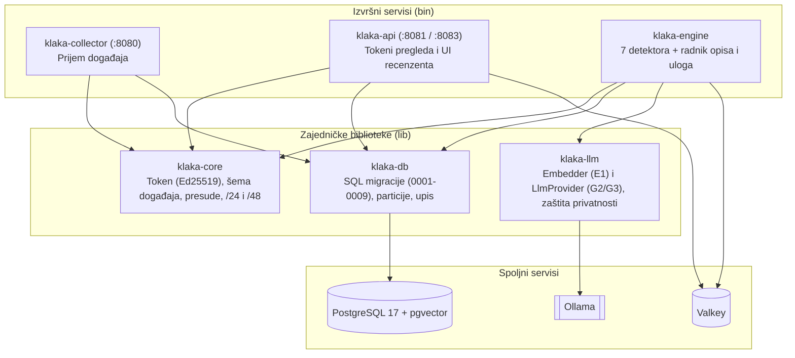

# klaka-core (Cargo workspace)

Serverski deo Klake u Rust-u (`edition = "2024"`, `#![forbid(unsafe_code)]`). Prima događaje iz
browsera i sa backenda portala, izdaje Ed25519 tokene pregleda, pronalazi koordinisane kohorte,
upisuje presude i naknadni shadow u Valkey i prikazuje dokaze u UI-ju recenzenta.

Arhitektura i izbor tehnologija: [`../docs/tech_stack.md`](../docs/tech_stack.md) §2–§3.

## Crate-ovi u workspace-u



| Crate | Tip | Uloga |
| --- | --- | --- |
| [`crates/klaka-core`](crates/klaka-core/) | lib | Zajednički tipovi protokola: Ed25519 token pregleda (`token`), šema događaja (`event`), format ključeva i presuda u Valkey-ju (`verdict`), skraćivanje IP adrese na `/24` i `/48` (`net`). |
| [`crates/klaka-db`](crates/klaka-db/) | lib | Pristup PostgreSQL-u (`sqlx`), SQL migracije (`migrations/0001`–`0009`), upis događaja i automatsko održavanje dnevnih particija tabele `events`. |
| [`crates/klaka-collector`](crates/klaka-collector/) | bin | HTTP servis (`:8080`) koji prima telemetriju iz browsera (`POST /v1/events`) i događaje sa backenda portala (`POST /v1/server`), skraćuje IP i upisuje pakete u PostgreSQL. |
| [`crates/klaka-api`](crates/klaka-api/) | bin | Dva odvojena HTTP listener-a: javni (`:8081`, `POST /v1/view` za izdavanje potpisanog tokena pregleda) i interni **UI recenzenta** (`:8083`, [`src/review.rs`](crates/klaka-api/src/review.rs) — red za pregled, detalj presude, potvrda i odbacivanje uz Askama HTML šablone). |
| [`crates/klaka-engine`](crates/klaka-engine/) | bin | Periodična analiza prozora događaja i pozadinski radnici:<ul><li>[`src/lib.rs`](crates/klaka-engine/src/lib.rs) — detektori `ghost-views`, `unread-votes`, `focused-votes` i izdavanje presude + naknadnog shadow-a (`issue_net_shadow`)</li><li>[`src/comments.rs`](crates/klaka-engine/src/comments.rs) — `unwritten-comments`, `shared-templates` (MinHash LSH + `pgvector` HNSW kNN 7 dana unazad) i `coordinated-templates` (graf na 2 koraka)</li><li>[`src/coordinated.rs`](crates/klaka-engine/src/coordinated.rs) — `coordinated-votes` (kandidati u ±120 s, Jaccard sličnost, $k$-jezgro i komponente povezanosti)</li><li>[`src/describe.rs`](crates/klaka-engine/src/describe.rs) — pozadinski radnik za LLM opis kohorte (`G2`/`G3`)</li><li>[`src/role.rs`](crates/klaka-engine/src/role.rs) — dodela uloge kohorte (**pojačivač**, **ćaci**, **razvodnjivač**) sa obrazloženjem i embeddings članaka</li></ul> |
| [`crates/klaka-llm`](crates/klaka-llm/) | lib | Interfejsi `Embedder` (`E1`) i `LlmProvider` (`G2`/`G3`) preko Ollama-e, zaštita `<input>` bloka od prompt injection-a i provera privatnosti u kodu (`Privacy::Personal` sme samo na lokalni backend). |

## Specifikacija i migracije

- [`spec/`](spec/) — izvor istine za protokol v1 ([`token.md`](spec/token.md), [`events.md`](spec/events.md), [`verdicts.md`](spec/verdicts.md), [`sdk.md`](spec/sdk.md)) i zajednički [`test-vectors/`](spec/test-vectors/) koje prolaze i Rust i svi SDK-ovi.
- [`migrations/`](migrations/) — šema PostgreSQL baze (`events` particije, `verdicts`, `verdict_retro`, `comment_embedding` HNSW, `verdict_review`, `cohort_summary`, `post_embedding`).

## Komande (iz korena repozitorijuma)

```bash
# Provera tipova, testovi i clippy u kontejneru
docker compose run --rm rust cargo check --workspace --all-targets
docker compose run --rm rust cargo test --workspace
docker compose run --rm rust cargo clippy --workspace --all-targets -- -D warnings

# Evaluacija generativnih modela za opis kohorte (docs/llm.md §7)
docker compose run --rm rust cargo run --release -p klaka-engine --example eval_g2 -- gemma3:4b gemma3:12b
```

